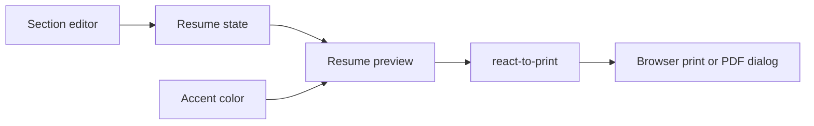

# Resume Builder

**Write your resume in structured sections and see the page take shape beside the editor.**

A React application with editable resume information, a live preview, accent-color selection, and a print workflow powered by `react-to-print`.

[Website](https://resume-builder-balaji.netlify.app/) · [Run locally](#run-locally) · [Architecture](#architecture)

## Why this project

Formatting a resume can distract from writing it. This project separates structured input from presentation: the editor collects information while the preview handles the page layout, helping students and job seekers focus on their experience and projects.

## Included features

- Sections for basic information, work experience, projects, education, achievements, summary, and other details.
- Editable section titles and repeated detail entries where supported.
- Live resume preview and five accent-color choices.
- A Download button that opens the browser print workflow.
- Home, editor, about, and contact routes.

## Run locally

Download and extract the repository. With Node.js and npm installed, run from the root:

```bash
npm install
npm start
```

Open `http://localhost:3000`; the resume editor is at `/body`.

```bash
npm run build
```

The Create React App build writes to `build/`. The website link above is retained from the repository's original README; hosting availability is separate from the source code.

## Example workflow

1. Open `/body` and fill in Basic Info.
2. Add education, work, or project details in the editor.
3. Review the page preview and choose an accent color.
4. Select **Download**, then choose **Save as PDF** in the browser print dialog if available.

The current editor stores resume information in React state. Save a copy before closing or refreshing the page; account storage and persistence are not implemented in this flow.

## Architecture



## Source guide

| Path | Responsibility |
| --- | --- |
| [src/App.js](src/App.js) | Navigation and routes |
| [src/components/Resume/resume.js](src/components/Resume/resume.js) | Resume state, colors, and printing |
| [src/components/Editor/Editor.js](src/components/Editor/Editor.js) | Section forms and updates |
| [src/components/Preview/Preview.js](src/components/Preview/Preview.js) | Resume presentation |
| [src/components/InputControl](src/components/InputControl) | Shared form controls |

## Development notes

Keep editor fields and preview rendering aligned when adding a section. Check print layout as well as screen layout, especially for long resumes. The application uses React Router, React Bootstrap, React Feather, and CSS modules.

The original README declared MIT licensing, but this repository currently has no separate license file. The earlier static performance badges are not reproduced as current test results.
